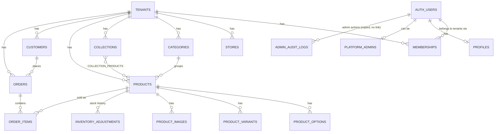

# StoreForge Data Model

The PostgreSQL database behind StoreForge. The schema and migrations are owned by the `store-forge-api` repository (see its `docs/DATABASE_SCHEMA.md`); this app does not access the database directly.

## Read this first

- **Tenant = organization.** Every business has one tenant. Almost every table has a `tenant_id` column, and a user can only ever see rows of their own tenant.
- **Money** is stored in the smallest unit as a whole number (for example paise or cents). Columns ending in `_minor` are money.
- **Sign-in accounts** live in Supabase's `auth.users` table. Our tables point to it with `user_id`.
- **Deleting a tenant deletes everything under it.** Its stores, products, customers, orders and memberships are removed with it.

## 1. How the tables connect



## 2. All tables

| Table | What it stores |
|---|---|
| `tenants` | One row per organization |
| `memberships` | Which user belongs to which tenant, and what they may do |
| `profiles` | A user's display name and avatar |
| `platform_admins` | The StoreForge staff who manage all organizations |
| `admin_audit_logs` | A permanent record of what Platform Admins did |
| `platform_settings` | One row of platform-wide settings (name, support email and defaults for new stores) |
| `rate_limits` | Counters that limit how often sensitive admin actions and sign-in attempts can happen |
| `stores` | A tenant's online store (name, web address, currency) |
| `categories` | Product categories, which can be nested |
| `collections` | Hand-picked groups of products |
| `collection_products` | Which products are in which collection |
| `products` | Items for sale |
| `product_options` | Option names and values of a product, for example Size: S, M, L |
| `product_variants` | One row per option combination, with its own price and stock |
| `product_images` | Pictures of a product |
| `inventory_adjustments` | Stock history: every change to stock is one row |
| `customers` | People who buy from a tenant |
| `orders` | Customer orders |
| `order_items` | The lines of an order |

## 3. Relationships

`many to one` means many rows in the first table point to one row in the second.

| This table | Points to | Through | Kind | If the target is deleted |
|---|---|---|---|---|
| `memberships` | `tenants` | `tenant_id` | many to one | membership deleted |
| `memberships` | `auth.users` | `user_id` | many to one | membership deleted |
| `profiles` | `auth.users` | `id` | one to one | profile deleted |
| `platform_admins` | `auth.users` | `user_id` | one to one | row deleted |
| `stores` | `tenants` | `tenant_id` | many to one | store deleted |
| `categories` | `tenants` | `tenant_id` | many to one | category deleted |
| `categories` | `categories` | `parent_id` | many to one (parent) | parent cleared |
| `collections` | `tenants` | `tenant_id` | many to one | collection deleted |
| `collection_products` | `collections` | `collection_id` | many to one | link deleted |
| `collection_products` | `products` | `product_id` | many to one | link deleted |
| `products` | `tenants` | `tenant_id` | many to one | product deleted |
| `products` | `categories` | `category_id` | many to one | category cleared |
| `product_options` | `products` | `product_id` | many to one | option deleted |
| `product_variants` | `products` | `product_id` | many to one | variant deleted |
| `product_variants` | `product_images` | `image_id` | many to one | image cleared |
| `product_images` | `products` | `product_id` | many to one | image deleted |
| `inventory_adjustments` | `products` | `product_id` | many to one | history deleted |
| `inventory_adjustments` | `product_variants` | `variant_id` | many to one | history deleted |
| `inventory_adjustments` | `auth.users` | `created_by` | many to one | user cleared |
| `customers` | `tenants` | `tenant_id` | many to one | customer deleted |
| `orders` | `tenants` | `tenant_id` | many to one | order deleted |
| `orders` | `customers` | `customer_id` | many to one | customer cleared |
| `order_items` | `orders` | `order_id` | many to one | item deleted |
| `order_items` | `products` | `product_id` | many to one | product cleared |
| `order_items` | `product_variants` | `variant_id` | many to one | variant cleared |

"Cleared" means the column becomes empty and the row stays. Order lines keep a copy of the product name and SKU, so deleting a product never erases order history.

Every table in the catalog and sales groups also has `tenant_id` pointing to `tenants` (deleted with the tenant).

## 4. Columns

Every table has an `id` (uuid, generated automatically) unless noted. Timestamp columns (`created_at`, and `updated_at` on tables whose rows get edited) are set automatically and are not listed below.

### Organizations and users

**`tenants`**

| Column | Type | Notes |
|---|---|---|
| `name` | text | Organization name |
| `slug` | text | Unique short name |
| `status` | text | `active` or `suspended`. A suspended tenant cannot be used by its members |
| `contact_phone` | text | Optional |
| `address` | text | Optional |
| `created_by` | uuid | The user who created it. Optional |

**`memberships`**: links one user to one tenant. A user can have only one membership per tenant.

| Column | Type | Notes |
|---|---|---|
| `tenant_id` | uuid | |
| `user_id` | uuid | |
| `role` | text | `owner` for the person who owns the tenant (at most one per tenant), `admin` for every team member. What a team member can do is set by `permissions`, not by the role |
| `status` | text | `active` or `disabled`. A disabled member has no access |
| `permissions` | jsonb | What a team member may do, see section 5 |

**`profiles`**

| Column | Type | Notes |
|---|---|---|
| `id` | uuid | Same as the user's id in `auth.users` |
| `full_name` | text | Optional |
| `avatar_url` | text | Optional |

**`admin_audit_logs`**: one row per action a Platform Admin takes. Rows can only be added, never changed or deleted, and nothing reads or writes the table directly.

| Column | Type | Notes |
|---|---|---|
| `admin_user_id` | uuid | The admin who did it, taken from their session. Not linked, so the log outlives the account |
| `admin_email` | text | Copied at the time of the action |
| `action` | text | For example `organization.created` or `ownership.transferred` |
| `entity_type` | text | `organization`, `store`, `team_member`, `platform_admin`, `support_note` or `platform_settings` |
| `entity_id` | uuid | What the action was about. Optional |
| `organization_id` | uuid | The organization involved. Not linked, so entries survive its deletion |
| `organization_name` | text | Copied at the time of the action |
| `description` | text | A short sentence, for example "Disabled team member a@b.com" |
| `previous_data` | jsonb | What changed, before. Passwords and tokens are never stored |
| `new_data` | jsonb | What changed, after |
| `created_at` | timestamptz | When it happened |

**`platform_admins`**: a person listed here manages all organizations. A platform admin can never also be a tenant member.

| Column | Type | Notes |
|---|---|---|
| `user_id` | uuid | Primary key |
| `role` | text | `super_admin` can also add or remove admins and change the platform settings. `admin` can do everything else. There is always at least one super admin |
| `created_by` | uuid | The admin who added them. Not linked, so it survives that admin's removal |

**`rate_limits`**: one row per person (or hashed sign-in subject) and time window. Nothing can read or write it directly.

| Column | Type | Notes |
|---|---|---|
| `key` | text | `<action>:<admin id>` for admin actions, or `login:<kind>:<keyed hash>` for sign-in attempts. No address or e-mail is stored |
| `window_start` | timestamptz | The start of the time window |
| `hits` | integer | Attempts counted in that window |

**`platform_settings`**: exactly one row.

| Column | Type | Notes |
|---|---|---|
| `platform_name` | text | Shown on the sign-in page and the "no workspace" page |
| `support_email` | text | Optional. Shown with the name |
| `default_currency` | text | Used for the store of each new organization |
| `default_timezone` | text | Same |
| `default_store_status` | text | `active` or `inactive`: how new stores start |

**`stores`**

| Column | Type | Notes |
|---|---|---|
| `tenant_id` | uuid | |
| `name` | text | |
| `slug` | text | Unique. The store's web address is `<slug>.<root domain>` |
| `description` | text | Optional |
| `logo_url` | text | Optional. A file path in storage |
| `currency` | text | Three letters, default `INR` |
| `timezone` | text | Default `Asia/Kolkata` |
| `status` | text | `active`, `inactive` or `suspended` |
| `contact_email` | text | Optional |
| `contact_phone` | text | Optional |

### Catalog

**`categories`**

| Column | Type | Notes |
|---|---|---|
| `tenant_id` | uuid | |
| `parent_id` | uuid | The parent category. Empty for a top-level category |
| `name` | text | |
| `slug` | text | Unique within the tenant |
| `description` | text | Optional |

**`collections`**

| Column | Type | Notes |
|---|---|---|
| `tenant_id` | uuid | |
| `name` | text | |
| `slug` | text | Unique within the tenant |
| `description` | text | Optional |
| `image_path` | text | Optional. A file path in storage |
| `status` | text | `draft` or `active` |

**`collection_products`**: no `id`. The pair `collection_id` + `product_id` is the key.

| Column | Type | Notes |
|---|---|---|
| `tenant_id` | uuid | |
| `collection_id` | uuid | |
| `product_id` | uuid | |
| `position` | integer | Order of the product inside the collection |

**`products`**

| Column | Type | Notes |
|---|---|---|
| `tenant_id` | uuid | |
| `category_id` | uuid | Optional |
| `name` | text | |
| `slug` | text | Unique within the tenant |
| `description` | text | Optional |
| `short_description` | text | Optional |
| `product_type` | text | Optional |
| `sku` | text | Optional. Unique within the tenant when set |
| `price_minor` | bigint | Selling price |
| `compare_at_price_minor` | bigint | Optional. The "was" price shown crossed out |
| `cost_minor` | bigint | Optional. What the product costs the seller |
| `has_variants` | boolean | True when prices and stock live on the variants |
| `track_inventory` | boolean | Whether stock is counted |
| `quantity` | integer | Stock on hand. Used when there are no variants |
| `low_stock_threshold` | integer | Warn when stock falls to this number |
| `status` | text | `draft` or `active`. Only active products show in the store |

**`product_options`**

| Column | Type | Notes |
|---|---|---|
| `tenant_id` | uuid | |
| `product_id` | uuid | |
| `name` | text | For example `Size`. Unique per product |
| `position` | integer | Display order |
| `values` | text[] | For example `{S, M, L}` |

**`product_variants`**

| Column | Type | Notes |
|---|---|---|
| `tenant_id` | uuid | |
| `product_id` | uuid | |
| `title` | text | For example `T-shirt / M` |
| `options` | jsonb | For example `{"Size": "M"}`. Unique per product |
| `sku` | text | Optional. Unique within the tenant when set |
| `price_minor` | bigint | |
| `compare_at_price_minor` | bigint | Optional |
| `quantity` | integer | Stock on hand |
| `image_id` | uuid | Optional. Must be an image of the same product |
| `is_active` | boolean | |
| `position` | integer | Display order |

**`product_images`**

| Column | Type | Notes |
|---|---|---|
| `tenant_id` | uuid | |
| `product_id` | uuid | |
| `storage_path` | text | Unique. Where the file is in storage |
| `alt_text` | text | Optional |
| `position` | integer | Display order |
| `is_primary` | boolean | The main picture. At most one per product |
| `mime_type` | text | `image/jpeg`, `image/png` or `image/webp` |
| `size_bytes` | integer | Up to 10 MB |

**`inventory_adjustments`**: a stock history that is only ever added to. Rows are never edited or deleted.

| Column | Type | Notes |
|---|---|---|
| `tenant_id` | uuid | |
| `product_id` | uuid | |
| `variant_id` | uuid | Optional |
| `delta` | integer | The change, for example `+10` or `-2`. Never 0 |
| `quantity_after` | integer | Stock after the change |
| `reason` | text | `restock`, `correction`, `return`, `damage`, `sale` or `other` |
| `note` | text | Optional |
| `created_by` | uuid | The user who made the change. Optional |

### Sales

**`customers`**

| Column | Type | Notes |
|---|---|---|
| `tenant_id` | uuid | |
| `email` | text | Unique within the tenant, ignoring upper and lower case |
| `full_name` | text | |
| `phone` | text | Optional |
| `notes` | text | Optional |

**`orders`**: read-only for now, because there is no checkout yet.

| Column | Type | Notes |
|---|---|---|
| `tenant_id` | uuid | |
| `customer_id` | uuid | Optional |
| `order_number` | integer | Unique within the tenant |
| `status` | text | `pending`, `paid`, `fulfilled`, `cancelled` or `refunded`. Paid and fulfilled count as revenue |
| `currency` | text | Three letters |
| `subtotal_minor` | bigint | |
| `total_minor` | bigint | |
| `placed_at` | timestamptz | When the order was placed |

**`order_items`**

| Column | Type | Notes |
|---|---|---|
| `tenant_id` | uuid | |
| `order_id` | uuid | |
| `product_id` | uuid | Optional. Cleared if the product is deleted |
| `variant_id` | uuid | Optional. Cleared if the variant is deleted |
| `name` | text | Copy of the product name at the time of purchase |
| `sku` | text | Optional. Copy of the SKU |
| `quantity` | integer | At least 1 |
| `unit_price_minor` | bigint | |
| `total_minor` | bigint | |

## 5. What a team member can do

The owner decides this per person, and it is saved in `memberships.permissions`. The owner always has full access.

```json
{ "products": "write", "orders": "read", "customers": "read", "settings": "read" }
```

| Key | Controls | Levels |
|---|---|---|
| `products` | Categories, collections, products, options, variants, images, stock | `none`, `read`, `write` |
| `orders` | Orders and order items | `none`, `read` |
| `customers` | Customers | `none`, `read`, `write` |
| `settings` | Changing the store and organization details. Everyone can always read them | `read`, `write` |

- `read` means can view. `write` means can view, create, edit and delete.
- A missing key means no access.
- The database enforces this, so it holds even if the app has a bug.

The Role shown in the app is only a shortcut that fills these levels in. It is not saved separately.

| Role shown | `products` | `orders` | `customers` | `settings` |
|---|---|---|---|---|
| Manager | write | read | write | write |
| Staff | write | read | write | read |
| Viewer | read | read | read | read |
| Custom | any other combination | | | |
