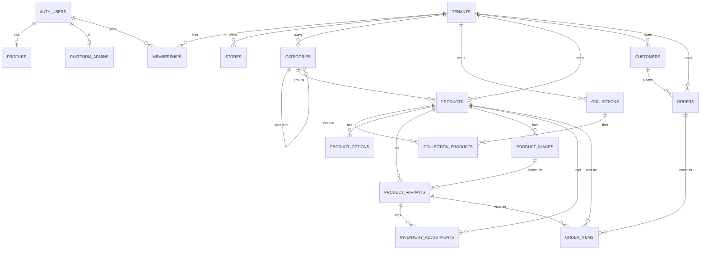

# StoreForge Data Model

The PostgreSQL schema behind StoreForge (Supabase). It is defined in `lib/db/schema/` (Drizzle) and created by the
migrations in `drizzle/` (`0000` to `0011`). This page describes the state after `0011_member_permissions`.

- **Multi-tenant.** A *tenant* is one organization (called "company" in older code and migrations). Every business
  table carries a `tenant_id`, and row level security (RLS) keeps each tenant's rows apart.
- **Money** is stored in minor units (`*_minor` bigint, for example paise or cents). Timestamps are `timestamptz`.
- **Text "enums"** are `text` columns with a `CHECK` constraint, not PostgreSQL enum types.
- **Supabase `auth.users`** holds the sign-in accounts and is not managed here. `public` tables reference it.

## 1. Tables at a glance

| Table | Area | Purpose | Rows belong to |
|---|---|---|---|
| `tenants` | Platform | An organization using StoreForge | itself |
| `memberships` | Platform | Links a user to a tenant, with status and per-module permissions | a tenant |
| `profiles` | Platform | Display name and avatar of a user (1:1 with `auth.users`) | a user |
| `platform_admins` | Platform | Users who run StoreForge itself | a user |
| `stores` | Platform | A tenant's storefront (name, address slug, currency) | a tenant |
| `categories` | Catalog | Nested product categories | a tenant |
| `collections` | Catalog | Hand-picked groups of products | a tenant |
| `collection_products` | Catalog | Which products are in which collection | a tenant |
| `products` | Catalog | Items for sale | a tenant |
| `product_options` | Catalog | Option names and values, for example Size: S, M, L | a tenant |
| `product_variants` | Catalog | One row per option combination, with its own price and stock | a tenant |
| `product_images` | Catalog | Image files of a product (stored in Supabase Storage) | a tenant |
| `inventory_adjustments` | Catalog | Append-only stock ledger | a tenant |
| `customers` | Sales | A tenant's customers | a tenant |
| `orders` | Sales | Customer orders (read-only for now) | a tenant |
| `order_items` | Sales | Line items of an order | a tenant |

## 2. Relationships

Every foreign key in the schema. "On delete" says what happens to this row when the referenced row is deleted.

### Platform

| From table.column | To table.column | Cardinality | On delete |
|---|---|---|---|
| `memberships.tenant_id` | `tenants.id` | many to one | cascade |
| `memberships.user_id` | `auth.users.id` | many to one | cascade |
| `profiles.id` | `auth.users.id` | one to one | cascade |
| `platform_admins.user_id` | `auth.users.id` | one to one | cascade |
| `tenants.created_by` | `auth.users.id` | many to one | set null |
| `stores.tenant_id` | `tenants.id` | many to one | cascade |

### Catalog

| From table.column | To table.column | Cardinality | On delete |
|---|---|---|---|
| `categories.tenant_id` | `tenants.id` | many to one | cascade |
| `categories.parent_id` | `categories.id` | many to one (self, tree) | set null |
| `collections.tenant_id` | `tenants.id` | many to one | cascade |
| `collection_products.tenant_id` | `tenants.id` | many to one | cascade |
| `collection_products.(tenant_id, collection_id)` | `collections.(tenant_id, id)` | many to one | cascade |
| `collection_products.(tenant_id, product_id)` | `products.(tenant_id, id)` | many to one | cascade |
| `products.tenant_id` | `tenants.id` | many to one | cascade |
| `products.category_id` | `categories.id` | many to one (optional) | set null |
| `product_options.tenant_id` | `tenants.id` | many to one | cascade |
| `product_options.(tenant_id, product_id)` | `products.(tenant_id, id)` | many to one | cascade |
| `product_variants.tenant_id` | `tenants.id` | many to one | cascade |
| `product_variants.(tenant_id, product_id)` | `products.(tenant_id, id)` | many to one | cascade |
| `product_variants.image_id` | `product_images.id` | many to one (optional) | set null |
| `product_images.tenant_id` | `tenants.id` | many to one | cascade |
| `product_images.(tenant_id, product_id)` | `products.(tenant_id, id)` | many to one | cascade |
| `inventory_adjustments.tenant_id` | `tenants.id` | many to one | cascade |
| `inventory_adjustments.(tenant_id, product_id)` | `products.(tenant_id, id)` | many to one | cascade |
| `inventory_adjustments.(tenant_id, variant_id)` | `product_variants.(tenant_id, id)` | many to one (optional) | cascade |
| `inventory_adjustments.created_by` | `auth.users.id` | many to one (optional) | set null |

### Sales

| From table.column | To table.column | Cardinality | On delete |
|---|---|---|---|
| `customers.tenant_id` | `tenants.id` | many to one | cascade |
| `orders.tenant_id` | `tenants.id` | many to one | cascade |
| `orders.customer_id` | `customers.id` | many to one (optional) | set null |
| `order_items.tenant_id` | `tenants.id` | many to one | cascade |
| `order_items.(tenant_id, order_id)` | `orders.(tenant_id, id)` | many to one | cascade |
| `order_items.product_id` | `products.id` | many to one (optional) | set null |
| `order_items.variant_id` | `product_variants.id` | many to one (optional) | set null |

**Why some keys are composite.** Child tables of products, collections and orders reference the parent through
`(tenant_id, id)`, which each parent makes unique. A row can therefore never point at another tenant's parent, even
by mistake. Order lines keep a copy of the product name and SKU and use `set null`, so deleting a product never
erases order history.

### In words

| One of this... | has many of these | through |
|---|---|---|
| `tenants` | `stores`, `memberships`, `categories`, `collections`, `products`, `customers`, `orders` | `tenant_id` |
| `auth.users` | `memberships` (one per tenant) | `user_id` |
| `categories` | child `categories`, and `products` | `parent_id`, `category_id` |
| `products` | `product_options`, `product_variants`, `product_images`, `inventory_adjustments` | `product_id` |
| `collections` | `products` (many to many) | `collection_products` |
| `customers` | `orders` | `customer_id` |
| `orders` | `order_items` | `order_id` |

## 3. Table definitions

`PK` primary key, `FK` foreign key, `UQ` unique, `NN` not null.

### 3.1 Platform

#### `tenants`

| Column | Type | Constraints | Notes |
|---|---|---|---|
| `id` | uuid | PK, default `gen_random_uuid()` | |
| `name` | text | NN, 2 to 80 characters | Organization name |
| `slug` | text | NN, UQ, `^[a-z0-9][a-z0-9-]{1,38}[a-z0-9]$` | |
| `created_by` | uuid | FK `auth.users`, set null | |
| `status` | text | NN, default `active`, `active` or `suspended` | A suspended tenant is invisible to its members |
| `contact_phone` | text | 4 to 32 characters | Nullable |
| `address` | text | up to 300 characters | Nullable |
| `created_at`, `updated_at` | timestamptz | NN, default `now()` | `updated_at` kept by trigger |

Index: `tenants_created_by_idx (created_by)`.

#### `memberships`

| Column | Type | Constraints | Notes |
|---|---|---|---|
| `id` | uuid | PK | |
| `tenant_id` | uuid | NN, FK `tenants`, cascade | |
| `user_id` | uuid | NN, FK `auth.users`, cascade | |
| `role` | text | NN, `owner`, `admin` or `staff` | See section 4. Team members are stored as `admin` |
| `status` | text | NN, default `active`, `active` or `disabled` | A disabled member has no access |
| `permissions` | jsonb | NN, default `{}`, validated by `is_valid_member_permissions()` | Per-module access, see section 4 |
| `created_at` | timestamptz | NN | |

Unique: `(tenant_id, user_id)`. Index: `memberships_user_id_idx (user_id)`.
A user is either a platform admin or a tenant member, never both (trigger `block_platform_admin_membership`).

#### `profiles`

| Column | Type | Constraints | Notes |
|---|---|---|---|
| `id` | uuid | PK, FK `auth.users`, cascade | |
| `full_name` | text | up to 120 characters | Created by the `on_auth_user_created` trigger |
| `avatar_url` | text | | |
| `created_at`, `updated_at` | timestamptz | NN | |

#### `platform_admins`

| Column | Type | Constraints | Notes |
|---|---|---|---|
| `user_id` | uuid | PK, FK `auth.users`, cascade | |
| `created_at` | timestamptz | NN | |

No grants and no policies: unreachable from the API. Rows are written only by `npm run admin:create`.

#### `stores`

| Column | Type | Constraints | Notes |
|---|---|---|---|
| `id` | uuid | PK | |
| `tenant_id` | uuid | NN, FK `tenants`, cascade | |
| `name` | text | NN, 2 to 80 characters | |
| `slug` | text | NN, UQ, same pattern as `tenants.slug` | Becomes `<slug>.<root domain>` |
| `description` | text | up to 500 characters | Nullable |
| `logo_url` | text | | Storage path, nullable |
| `currency` | text | NN, default `INR`, `^[A-Z]{3}$` | |
| `timezone` | text | NN, default `Asia/Kolkata` | |
| `status` | text | NN, default `active`, `active`, `inactive` or `suspended` | |
| `contact_email` | text | up to 254 characters, contains `@` | Nullable |
| `contact_phone` | text | 4 to 32 characters | Nullable |
| `created_at`, `updated_at` | timestamptz | NN | |

Index: `stores_tenant_id_idx (tenant_id)`.

### 3.2 Catalog

#### `categories`

| Column | Type | Constraints | Notes |
|---|---|---|---|
| `id` | uuid | PK | |
| `tenant_id` | uuid | NN, FK | |
| `parent_id` | uuid | FK `categories`, set null, must differ from `id` | Nullable, builds the tree |
| `name` | text | NN, 1 to 80 characters | |
| `slug` | text | NN, 2 to 80 characters, kebab-case | |
| `description` | text | up to 1000 characters | Nullable |
| `created_at`, `updated_at` | timestamptz | NN | |

Unique: `(tenant_id, id)`, `(tenant_id, slug)`. Index: `categories_parent_id_idx`.

#### `collections`

| Column | Type | Constraints | Notes |
|---|---|---|---|
| `id` | uuid | PK | |
| `tenant_id` | uuid | NN, FK | |
| `name` | text | NN, 1 to 80 characters | |
| `slug` | text | NN, 2 to 80 characters, kebab-case | |
| `description` | text | up to 1000 characters | Nullable |
| `image_path` | text | must start with `{tenant_id}/collections/{id}/` | Nullable |
| `status` | text | NN, default `draft`, `draft` or `active` | |
| `created_at`, `updated_at` | timestamptz | NN | |

Unique: `(tenant_id, id)`, `(tenant_id, slug)`.

#### `collection_products`

| Column | Type | Constraints | Notes |
|---|---|---|---|
| `tenant_id` | uuid | NN, FK | |
| `collection_id` | uuid | PK part, composite FK | |
| `product_id` | uuid | PK part, composite FK | |
| `position` | integer | NN, default 0 | Order inside the collection |
| `created_at` | timestamptz | NN | |

Primary key: `(collection_id, product_id)`. Index: `collection_products_product_id_idx`.

#### `products`

| Column | Type | Constraints | Notes |
|---|---|---|---|
| `id` | uuid | PK | |
| `tenant_id` | uuid | NN, FK | |
| `category_id` | uuid | FK `categories`, set null | Nullable |
| `name` | text | NN, 1 to 200 characters | |
| `slug` | text | NN, 2 to 80 characters, kebab-case | |
| `description` | text | up to 20000 characters | Nullable |
| `short_description` | text | up to 300 characters | Nullable |
| `product_type` | text | up to 80 characters | Nullable |
| `sku` | text | 1 to 64 characters | Nullable |
| `price_minor` | bigint | NN, default 0, 0 to 100000000000 | |
| `compare_at_price_minor` | bigint | 0 to 100000000000 | Nullable, "was" price |
| `cost_minor` | bigint | 0 to 100000000000 | Nullable |
| `has_variants` | boolean | NN, default false | |
| `track_inventory` | boolean | NN, default true | |
| `quantity` | integer | NN, default 0, at least 0 | Used when there are no variants |
| `low_stock_threshold` | integer | NN, default 5, at least 0 | |
| `status` | text | NN, default `draft`, `draft` or `active` | |
| `created_at`, `updated_at` | timestamptz | NN | |

Unique: `(tenant_id, id)`, `(tenant_id, slug)`, `(tenant_id, sku)` where `sku` is not null.
Indexes: `(tenant_id, status)`, `(tenant_id, created_at desc)`, `(category_id)`.

#### `product_options`

| Column | Type | Constraints | Notes |
|---|---|---|---|
| `id` | uuid | PK | |
| `tenant_id` | uuid | NN, FK | |
| `product_id` | uuid | NN, composite FK | |
| `name` | text | NN, 1 to 40 characters | For example "Size" |
| `position` | integer | NN, default 0 | |
| `values` | text[] | NN, 1 to 50 items | For example `{S,M,L}` |

Unique: `(product_id, name)`. Index: `product_options_product_id_idx`.

#### `product_variants`

| Column | Type | Constraints | Notes |
|---|---|---|---|
| `id` | uuid | PK | |
| `tenant_id` | uuid | NN, FK | |
| `product_id` | uuid | NN, composite FK | |
| `title` | text | NN, 1 to 200 characters | |
| `options` | jsonb | NN | For example `{"Size":"M"}` |
| `sku` | text | 1 to 64 characters | Nullable |
| `price_minor` | bigint | NN, default 0, 0 to 100000000000 | |
| `compare_at_price_minor` | bigint | 0 to 100000000000 | Nullable |
| `quantity` | integer | NN, default 0, at least 0 | |
| `image_id` | uuid | FK `product_images`, set null | Must belong to the same product |
| `is_active` | boolean | NN, default true | |
| `position` | integer | NN, default 0 | |
| `created_at`, `updated_at` | timestamptz | NN | |

Unique: `(tenant_id, id)`, `(product_id, options)`, `(tenant_id, sku)` where `sku` is not null. Index: `(product_id, position)`.

#### `product_images`

| Column | Type | Constraints | Notes |
|---|---|---|---|
| `id` | uuid | PK | |
| `tenant_id` | uuid | NN, FK | |
| `product_id` | uuid | NN, composite FK | |
| `storage_path` | text | NN, UQ, must start `{tenant_id}/{product_id}/`, no `..` | Supabase Storage bucket `products` |
| `alt_text` | text | up to 300 characters | Nullable |
| `position` | integer | NN, default 0 | |
| `is_primary` | boolean | NN, default false | At most one primary per product |
| `mime_type` | text | NN, `image/jpeg`, `image/png` or `image/webp` | |
| `size_bytes` | integer | NN, 1 to 10485760 | |
| `created_at` | timestamptz | NN | |

Unique: `(tenant_id, id)`, one primary per product (partial unique index). Index: `(product_id, position)`.

#### `inventory_adjustments`

Append-only: rows can be inserted and read, never updated or deleted.

| Column | Type | Constraints | Notes |
|---|---|---|---|
| `id` | uuid | PK | |
| `tenant_id` | uuid | NN, FK | |
| `product_id` | uuid | NN, composite FK | |
| `variant_id` | uuid | composite FK | Nullable |
| `delta` | integer | NN, not 0 | Change in stock |
| `quantity_after` | integer | NN, at least 0 | Stock after the change |
| `reason` | text | NN, `restock`, `correction`, `return`, `damage`, `sale` or `other` | |
| `note` | text | up to 500 characters | Nullable |
| `created_by` | uuid | FK `auth.users`, set null | Nullable |
| `created_at` | timestamptz | NN | |

Indexes: `(product_id, created_at desc)`, `(tenant_id, created_at desc)`.

### 3.3 Sales

#### `customers`

| Column | Type | Constraints | Notes |
|---|---|---|---|
| `id` | uuid | PK | |
| `tenant_id` | uuid | NN, FK | |
| `email` | text | NN, 3 to 254 characters, contains `@` | |
| `full_name` | text | NN, 1 to 120 characters | |
| `phone` | text | 4 to 32 characters | Nullable |
| `notes` | text | up to 2000 characters | Nullable |
| `created_at`, `updated_at` | timestamptz | NN | |

Unique: `(tenant_id, id)`, `(tenant_id, lower(email))`. Index: `(tenant_id, created_at desc)`.

#### `orders`

Read-only for application roles for now (no checkout yet).

| Column | Type | Constraints | Notes |
|---|---|---|---|
| `id` | uuid | PK | |
| `tenant_id` | uuid | NN, FK | |
| `customer_id` | uuid | FK `customers`, set null | Nullable |
| `order_number` | integer | NN | Per tenant |
| `status` | text | NN, default `pending`, `pending`, `paid`, `fulfilled`, `cancelled` or `refunded` | `paid` and `fulfilled` count as revenue |
| `currency` | text | NN, `^[A-Z]{3}$` | |
| `subtotal_minor`, `total_minor` | bigint | NN, at least 0 | |
| `placed_at`, `created_at` | timestamptz | NN | |

Unique: `(tenant_id, id)`, `(tenant_id, order_number)`. Indexes: `(tenant_id, placed_at desc)`, `(customer_id)`.

#### `order_items`

| Column | Type | Constraints | Notes |
|---|---|---|---|
| `id` | uuid | PK | |
| `tenant_id` | uuid | NN, FK | |
| `order_id` | uuid | NN, composite FK | |
| `product_id` | uuid | FK `products`, set null | Nullable |
| `variant_id` | uuid | FK `product_variants`, set null | Nullable |
| `name` | text | NN | Copy of the product name at purchase time |
| `sku` | text | | Copy, nullable |
| `quantity` | integer | NN, greater than 0 | |
| `unit_price_minor`, `total_minor` | bigint | NN, at least 0 | |

Indexes: `(order_id)`, `(product_id)`.

## 4. Access model

A member's access is decided by their **permissions**, stored on the membership. The Owner grants and revokes them
from the Team members page.

`memberships.permissions` is a JSON object with one key per module. A missing key means no access.

| Module key | Covers these tables | Levels the Owner can set |
|---|---|---|
| `products` | `categories`, `collections`, `collection_products`, `products`, `product_options`, `product_variants`, `product_images`, `inventory_adjustments`, and the `products` storage bucket | `none`, `read`, `write` |
| `orders` | `orders`, `order_items` | `none`, `read` (orders are read-only for now) |
| `customers` | `customers` | `none`, `read`, `write` |
| `settings` | `stores`, `tenants` (writes only) | `read`, `write` (reading is always allowed) |

`write` includes `read`. The Owner always has full access. Allowed levels are checked by
`is_valid_member_permissions()` and by the forms.

| Role shown in the UI | `products` | `orders` | `customers` | `settings` |
|---|---|---|---|---|
| Manager | write | read | write | write |
| Staff | write | read | write | read |
| Viewer | read | read | read | read |
| Custom | any other combination | | | |

The role is only a preset and is not stored separately; it is worked out from the permissions.

| `memberships.role` value | Meaning |
|---|---|
| `owner` | Created when the organization is created. Cannot be changed, removed or assigned through the API |
| `admin` | Every team member. What they can do is set by `permissions`, not by this value |
| `staff` | Legacy. Existing rows were converted to `admin` by `0011` |

## 5. Functions and triggers

| Name | Kind | Purpose |
|---|---|---|
| `is_tenant_member(tenant)` | RLS helper | Active member of an active tenant |
| `has_tenant_role(tenant, roles[])` | RLS helper | Active member with one of the roles |
| `has_module_access(tenant, module, level)` | RLS helper | Module access from `memberships.permissions`; Owner always passes |
| `is_valid_member_permissions(jsonb)` | Constraint helper | Checks keys and levels of `permissions` |
| `is_platform_admin()` | RLS helper | Caller is in `platform_admins` |
| `platform_provision_tenant(...)` | Platform admin | Creates tenant, owner membership and store in one step |
| `platform_list_tenants(id)` | Platform admin | Lists organizations with owner and member count |
| `platform_set_tenant_status(id, status)` | Platform admin | Suspend or reactivate |
| `platform_add_member(tenant, user, permissions)` | Platform admin | Adds a team member to any organization |
| `list_tenant_team(tenant)` | Owner or platform admin | Team with email, status and permissions |
| `update_team_member_name(...)`, `remove_team_member(...)` | Owner | Edit a name, remove a member |
| `is_valid_store_slug(slug)`, `is_store_slug_available(slug)` | Helper | Store address checks |
| `get_public_storefront(slug)` | Public storefront | Safe read-only data for `<slug>.<root domain>` |
| `storage_path_tenant(path)`, `can_write_storage_object(path)` | Storage | Tenant from a file path; write needs `products` write, or `settings` write for `{tenant}/store/...` |
| `set_updated_at()` | Trigger | Keeps `updated_at` current on tenants, stores, profiles, categories, collections, products, product_variants, customers |
| `handle_new_user()` | Trigger | Creates a `profiles` row for each new `auth.users` row |
| `block_platform_admin_membership()` | Trigger | A user cannot be both a platform admin and a tenant member |

## 6. Entity relationship diagram

